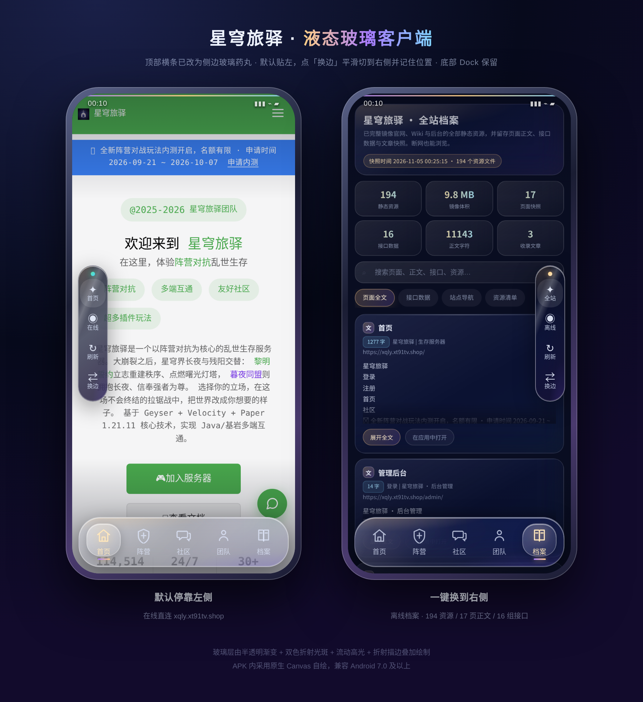
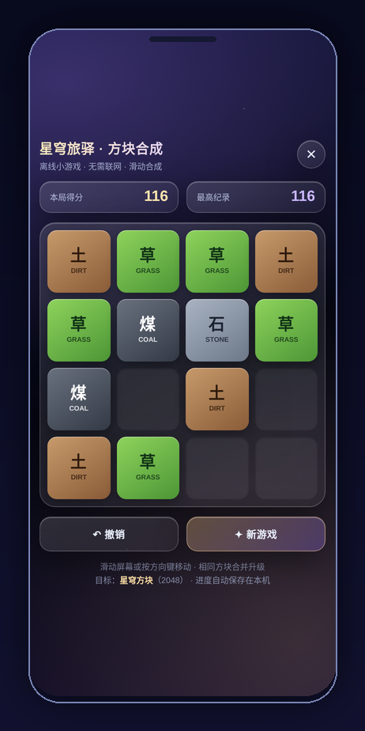
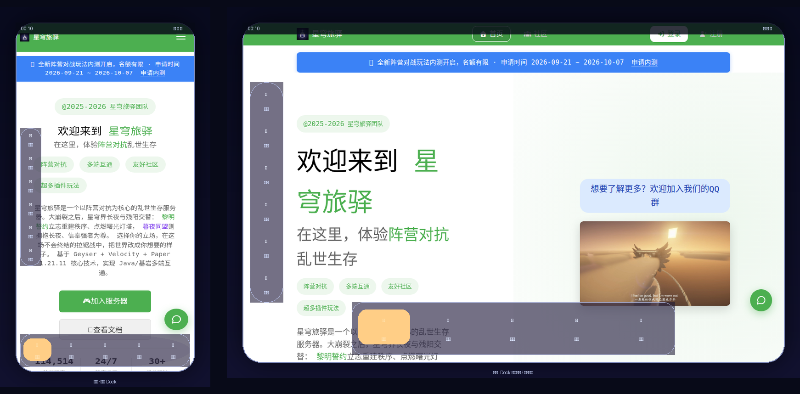

# 星穹旅驿 · 官方双平台客户端（Android + Windows）

**由星穹旅驿服务器运营团队官方发布**，官网：[xqly.xt91tv.shop](https://xqly.xt91tv.shop)。

**原生 Android**（Java + 系统 WebView）与 **原生 Windows**（Win32 窗口程序）双客户端，共用一套纯 Dart 业务核心。在线直连与离线镜像两种模式均可完整使用；内置「全站内容档案」与本地全文检索，离线时还有小游戏「方块合成」；支持平板 / 横屏 / 折叠屏自适应与可信自动更新。

当前版本 **v2.1.1**（Android `versionCode=8` / Windows `2.1.1.0`）。

> 📦 直接到 [Releases](https://github.com/ChaosSurvivalProject/xqly-app/releases) 下载已正式签名的 Android APK，安装即用。

> ✅ **关于 Windows 产物**：安装版（MSIX）与便携版（ZIP）由 [`.github/workflows/release.yml`](.github/workflows/release.yml) 在 `windows-latest`（Visual Studio Enterprise 2026）真实编译产出，随每个草稿 Release 一起发布；目前为**测试签名**（未配置组织代码签名证书），不伪装正式版。本仓库开发沙箱是 Linux，本机不产生 Windows 二进制，但 Win32 源码完整可审计、平台无关核心已编译测试。详见 [windows/README.md](windows/README.md)。



---

## v2.1.1 更新重点（紧急修复 · UI 层叠 / 无法关闭 · 性能优化）

修复 v2.1.0 资料库原生化引入的**致命 UI 回归**：界面层层叠叠、卡住动不了、关闭不了、跳转后无法关闭。

- **根因**：`buildLibraryOverlay()` 漏了 `setVisibility(GONE)`，资料库浮层从启动就透明叠加在主 WebView 上；`libraryOpen` 标志却仍为 `false`，返回键与桥接关闭消息都关不掉它；上层 `FrameLayout` 吃掉触摸，下层页面点不到。
- **修复**：新增零依赖 `core/OverlayController`，把浮层可见性收敛为唯一真源，每次变更下发「完整迁移」无条件重设所有浮层（先取消动画并复位），保证任意时刻最多一个浮层可见；所有跳转/关闭路径统一 `closeAllOverlays()`；浮层改不透明背景；新增「✦ 首页」一键逃生出口；启动页 8 秒兜底 + 加载超时 20s→12s，错误态不再被遮罩挡住。
- **回归测试**：新增 8 个 JVM 用例，含 200 步随机操作序列验证「可见浮层数恒 ≤ 1」；`build.sh` 12 步门禁全过，**测试合计 323 用例**（Dart 152 + JVM 118 + Node 19 + C++ 34）。
- **性能优化**：`GlowView` 渐变对象每帧零分配 + 重绘节流到 ~25fps；启动页隐藏时移除视图以停止无限动画；内置浮层延迟加载；隐藏 WebView 不再被逐个唤醒；桥接广播与主题注入只投递可见页面；资料库输入防抖 120ms、收藏切换只改内存集合。
- **发布链收尾**：`gh release create --target` 修好 `untagged-*` 链接；Windows 资产改 ASCII 名；草稿幂等重建。

详见 [docs/RELEASE_NOTES_2.1.1.md](docs/RELEASE_NOTES_2.1.1.md)。

---

## v2.1.0 更新重点（双端更新 · UI 重写 · 性能优化 · 本地优先同步）

这是一次**面向双端体验**的迭代，可验证项均通过 `build.sh` 12 步门禁与本机构建：

- **资料库原生 UI 重写**：资料库（Library）从「WebView 壳 + 内置 HTML」改为**纯原生星穹玻璃组件**（`GlassCard` / `GlassSearchBar` / `GlassChip` / `GlassButton` + 原生 `StateOverlay`）。实时本地搜索、收藏筛选、标签筛选、星标卡片全部用原生 `FrameLayout`/`LinearLayout` 自绘，复用同一套 `SearchIndex` 与 `UserData`，不再加载 WebView。
- **性能优化（真实可验证）**：收藏/取消收藏不再重建整张倒排索引（原每次切换都是 O(全量文档·词) 的分词成本），改为只维护一个 `favSet` 覆盖层 + 搜索时按集合过滤，收藏高频操作降到 O(结果数)。
- **本地优先 + 可选云端同步引擎**：新增 `SyncEngine`（纯 Java、`core` 包，零 Android 依赖）。默认**只做本地** `.xqlypack` 导出/导入（带 schema、设备 id、生成时间与 SHA-256 校验和，篡改/截断/降 schema 整体拒绝）；云端传输是**可插拔接口且默认关闭**，绝不自行联网、绝不硬编码端点、绝不伪造凭据。`cloud_sync` 功能开关默认 `false`。
- **Windows 端同步**：Win32 外壳共用同一套同步语义；二进制仍由 `release.yml` 在 `windows-latest` 产出（开发沙箱无 MSVC/SDK/签名证书，本机不伪造）。
- **版本号统一提升**：Android `versionCode=7` / `versionName=2.1.0`，Windows `2.1.0.0`，与 Dart 共享核心、构建脚本、资源头六处真源一致，门禁逐字校验。

> 说明（如实标注）：游戏（方块合成）与离线档案（archive）当前仍由**本机 WebView 承载**原生页面，未做与资料库同级别的原生组件重写；这是下一阶段计划项，本次未虚构其完成。

**测试合计 315 个用例**：Dart 152 + JVM 110 + Node 19 + C++ 34，全部通过；`build.sh` 12 步门禁通过并产出正式签名 APK。

---

## v2.0.1 更新重点（历史）

这是一次**双平台工程基线 + 合规发布链**升级，不是换皮：

- **纯 Dart 双平台共享核心**：`shared/` 16 个模块、零第三方依赖，统一身份/版本、可信更新链、URL 白名单、版本化桥、内容清单、设计令牌、功能开关、全状态、游戏规则、本地检索、SHA-256、同步包与冲突合并。`dart pub get --offline` 即可构建，**152 个测试通过**。
- **设计令牌一处真源**：`shared/tool/gen_tokens.dart` 生成 `assets/design-tokens.css`（Android）、`windows/runner/resources/design-tokens.json`（Windows）与 `shared/design-tokens.json`，构建时做字节一致性门禁，杜绝双平台视觉漂移。
- **原生 Windows 外壳**：`wWinMain` + `HWND` + 消息循环（不是浏览器窗口壳）；平台无关 C++17 核心在 Linux 上真实编译并跑通 **34 个测试**；实现 DPI/多显示器、多标签与快捷键、托盘、开机启动（默认关闭）、文件关联、自定义协议、触屏输入、WebView2 检测。
- **本地优先跨设备同步**：`.xqlypack` 同步包含校验和、Lamport 时钟与墓碑；截断/篡改整体拒绝；标签并集合并、阅读进度同时钟冲突交用户确认、游戏存档不盲目覆盖。云端接口只定义形状，**默认关闭且显示「未配置」**。
- **自有设计语言清理**：全面改用「星穹玻璃」与中性字体栈，清除厂商品牌模仿性描述；CI 对 `*.java` / `*.md` / `*.dart` / `*.cpp` 做品牌词扫描。
- **12 步构建门禁**：在原有 JVM / Node 测试之上增加 Dart 静态分析、令牌生成与校验、Dart 152 测试、APK 内 `MANIFEST.json` / `design-tokens.css` 字节比对。
- **合规与发布链**：新增 [权限说明](docs/PERMISSIONS.md)、[第三方依赖清单](docs/THIRD_PARTY.md)、[软件物料清单（SPDX 2.3）](docs/dual-platform/SBOM.md)；双平台 CI 与 Release 草稿流水线；从真实产物生成 `SHA256SUMS.txt` 与 SBOM。

**测试合计 309 个用例**：Dart 152 + JVM 104 + Node 19 + C++ 34，全部通过；`build.sh` 12 步门禁通过并产出正式签名 APK。

> 技术决策证据（为什么不做全量 Flutter 重写）、可复用/必须替换模块、平台差异与风险见 [双平台审计报告](docs/dual-platform/AUDIT_2.0.1.md)；逐模块映射与人工补齐清单见 [迁移映射](docs/dual-platform/MIGRATION_MAP.md)；已验证 / 未验证边界见 [验收报告](docs/dual-platform/ACCEPTANCE_2.0.1.md)。

历史版本：v2.0.0 完成安全加固、星穹玻璃设计系统、可信更新链与方块合成 2.0；v1.3.0 重构导航栏（星穹玻璃药丸容器、邻近放大、选中磨砂玻璃药丸、顶部受光高光、滚动收拢）；v1.2.0 加入平板适配与自动更新；v1.1.0 加入在线/离线双模式与离线小游戏。

---

## 特性

- **双模式均可使用**：在线直连官网，登录、发帖等写操作完全可用；离线走内置全站镜像，浏览正文、Wiki、社区帖子不受网络影响。网络异常时自动降级。
- **离线镜像**：`WebViewClient.shouldInterceptRequest` 映射到内置资源，含 SPA history fallback、按扩展名 MIME 判定、API JSON 快照回放；随包清单 228 个文件做 SHA-256 校验。
- **星穹玻璃界面**：深/浅主题 × 星穹玻璃 / 原生节能 / 增强可读三模式；侧边玻璃药丸、底部 Dock 邻近放大与激活玻璃药丸；平板/横屏/折叠屏切换竖向 rail。
- **全站档案 / 资料检索**：内置可搜索档案页与资料页，CJK 单字/bigram、标题/标签加权、高亮预览，断网可搜。**是纯本地检索，不是 AI，不联网上传**。
- **方块合成 2.0**：确定性规则引擎、3 次撤销、Hold/下一块预览、每日挑战、成就、色盲友好形状、暂停/恢复。无广告、无付费、无联网。
- **可信自动更新**：发布者钉扎 + Release 严格解析 + 下载主机白名单 + 整包 SHA-256 + APK 签名证书指纹钉扎 + 版本/versionCode 非降级；支持进度、取消与断点续传；校验失败只删临时文件，当前版本完好。
- **桌面专属体验**：多标签与拖拽、Ctrl+T/W/Tab/F/K/, F5/Ctrl+R/Esc 快捷键、窗口状态持久化、托盘、单实例、文件关联与 `xqly://app/` 协议、触屏/触控笔等价输入。
- **数据隔离**：用户数据与缓存分文件，schema 0→2 逐级迁移；清理缓存不会删除收藏、历史、阅读进度或游戏存档。




---

## 内容规模

| 项目 | 数量 |
|---|---|
| 镜像静态资源 | 202 个文件 / 约 10.4 MB（主站 + `/wiki/` + `/admin/`） |
| 页面正文 | 17 页 / 11,143 字 |
| 接口数据快照 | 16 组 JSON |
| 内置内容清单 | **228 个文件 / 10,531,971 bytes（10.04 MB）** |
| 本地检索索引 | 13 条真实文档 |
| `assets/` 实际文件 | 229（含 `MANIFEST.json` 自身，清单不纳入自己） |
| Java 源码 | 32 个文件 / 5,909 行（含 17 个零 Android 依赖的纯逻辑类） |
| Dart 源码 | 19 个 `.dart`（16 个共享模块 + 入口 + 生成器 + 测试） |
| C++ 源码 | 11 个 `.cpp` / `.h` |
| 自动化测试 | **323 个用例**（Dart 152 + JVM 118 + Node 19 + C++ 34） |
| Android APK | 6,665,650 bytes，正式签名 |

---

## 快速开始

### 环境要求

| 平台 | 依赖 |
|---|---|
| 通用 | Python 3.11、Node.js 22、Dart SDK 2.17.0、`zip` / `unzip` |
| Android | JDK 8+（本机实测 javac 20，CI 锁定 Temurin 17）、`platforms;android-35`、`build-tools;35.0.0` |
| Windows 核心（Linux 也能跑） | CMake ≥3.15、C++17 编译器 |
| Windows 外壳（**仅 Windows 主机**） | Visual Studio 2022「使用 C++ 的桌面开发」+ Windows 10/11 SDK + `makeappx.exe` |
| 复现爬取（可选） | Python `requests` / `playwright` + Chromium |

```bash
sdkmanager "platforms;android-35" "build-tools;35.0.0"
export ANDROID_HOME=/path/to/android-sdk
```

### 构建 Android

```bash
git clone <本仓库地址>
cd xqly-app
bash build.sh          # 12 步门禁，任一环节失败即中止
```

| 步骤 | 内容 |
|---|---|
| 0 | 校验 Manifest / MainActivity / build.sh / Dart identity 四处版本一致性与工具链 |
| 1 | Dart 静态分析 + 设计令牌生成与 `--check` |
| 2 | 生成并校验 `search-index.json` 与 `MANIFEST.json`（**必须先于测试**） |
| 3 | Dart 共享核心测试（152） |
| 4 | JVM 逻辑测试（104） |
| 5 | Node 游戏规则引擎测试（19） |
| 6–9 | aapt2 编译/链接 → javac → d8 |
| 10 | 组装 APK 并 zipalign |
| 11 | 比对 APK 内 `MANIFEST.json` / `design-tokens.css` 与源码树字节一致 |
| 12 | 签名（v1/v2/v3）→ `apksigner verify` → 输出 SHA-256 与证书指纹 |

单独跑测试：

```bash
(cd shared && dart test/run_tests.dart ..)     # 152
bash tests/run-tests.sh                        # 104
node tests/game-engine.test.js                 # 19
cmake -S windows/runner/core -B /tmp/wincore && cmake --build /tmp/wincore -j2 && ctest --test-dir /tmp/wincore --output-on-failure   # 34
python3 tools/gen_manifest.py --check
python3 tools/gen_search_index.py --check
(cd shared && dart tool/gen_tokens.dart .. --check)
```

### 构建 Windows

```powershell
cmake -S windows -B windows/build -G "Visual Studio 17 2022" -A x64
cmake --build windows/build --config Release
# 产物：windows/build/Release/xqly.exe
.\windows\tests\smoke.ps1 -Exe .\windows\build\Release\xqly.exe
```

打包 MSIX / 便携 ZIP / 签名见 [windows/README.md](windows/README.md) 与 `windows/packaging/`。**无正式代码签名证书时，签名脚本明确输出 `SIGN_RESULT=UNSIGNED`，产物必须标注测试版，不得伪装正式发布。**

### 可覆盖的环境变量

| 变量 | 默认值 | 说明 |
|---|---|---|
| `ANDROID_HOME` / `ANDROID_SDK_ROOT` | `/opt/android-sdk` | SDK 路径 |
| `ANDROID_BUILD_TOOLS` / `ANDROID_PLATFORM` | `35.0.0` / `android-35` | 锁定版本 |
| `OUT` | `dist/星穹旅驿.apk` | APK 输出路径 |
| `KS` | `~/.xqly-keys/xqly.jks`，否则 `build/xqly.jks` | 签名密钥，可指向仓库外私有密钥 |
| `KS_PASS` / `KEY_PASS` | `xqly2026` | 调试密钥口令，正式发布请用私有密钥 |
| `DART` | `command -v dart` | Dart SDK 路径 |

**正式发布务必使用仓库外私有密钥**；脚本回退到调试密钥会打印警告，该产物无法覆盖升级。`.jks`、`build/`、`dist/`、`.dart_tool/` 均已被 `.gitignore` 排除，**任何情况下都不要把签名私钥、证书或 Token 提交到公开仓库**。

### 安装

**方式一（推荐）**：到 [Releases](https://github.com/ChaosSurvivalProject/xqly-app/releases) 下载 `xqly-app-v2.1.1.apk`，点击安装；应用内也支持自动更新。

**方式二**：本地编译后 `adb install -r dist/星穹旅驿.apk`。

`minSdk 24`（Android 7.0+）。APK 为自签名，安装时提示「未知来源」属正常；从 v1.1.0 起所有版本使用同一签名证书，覆盖安装不会冲突。校验方式：

```bash
sha256sum -c SHA256SUMS.txt
apksigner verify --print-certs xqly-app-v2.1.1.apk | grep SHA-256
# 期望: e1e8edc56e9700a27ab2cd4ba5f45fa0ba1bd9a88e4a261de7ef3684b3c21c05
```

### 复现离线镜像

```bash
pip install requests playwright && playwright install chromium
python3 tools/mirror.py --all      # 重新抓取全站镜像
python3 tools/verify_offline.py    # 校验镜像能否完整渲染
python3 tools/redact.py --apply    # 可选：脱敏后重新发布
python3 tools/gen_search_index.py
python3 tools/gen_manifest.py      # 重建内容清单（内容未变化时保持幂等）
```

---

## 发布与更新

```bash
export GH_TOKEN=<你的 Personal Access Token>
bash scripts/publish.sh            # 推送源码（5 次重试 + 远端 HEAD 校验）
python3 tools/gen_release_assets.py release/ 2.1.1   # 从真实产物生成摘要与 SBOM
gh release create v2.1.1 release/* --repo ChaosSurvivalProject/xqly-app \
  --title "星穹旅驿 2.1.1 · Windows + Android" \
  --notes-file docs/RELEASE_NOTES_2.1.1.md --draft \
  --target "$(git rev-parse HEAD)"
```

令牌只在运行时从环境变量读取，不写入仓库或 git 配置；git 认证头只对 `github.com` 主机生效。CI 中打 tag 会触发 `release.yml` 自动创建**草稿**，并下载资产做 `sha256sum -c` 校验；若 Release 已由本机正式签名发布，流水线会跳过创建以免覆盖。

OTA 主资产名硬约束为 `xqly-app-v<version>.apk`，中文名只是附加下载别名。完整命名规则、可信更新链与回滚步骤见 [发布指南](docs/RELEASE.md) 与 [SBOM](docs/dual-platform/SBOM.md)。

---

## 文档

| 文档 | 内容 |
|---|---|
| [v2.0.1 验收报告](docs/dual-platform/ACCEPTANCE_2.0.1.md) | 逐项已验证/未验证、测试数字、产物哈希、人工补齐 |
| [双平台审计报告](docs/dual-platform/AUDIT_2.0.1.md) | 环境事实证据、技术决策、可复用/必须替换模块、平台差异与风险 |
| [迁移映射](docs/dual-platform/MIGRATION_MAP.md) | 逐模块映射、全量 Flutter 迁移成本、11 项人工补齐清单、回滚策略 |
| [软件物料清单](docs/dual-platform/SBOM.md) | SPDX 2.3 组件清单、产物清单、可复现性边界 |
| [权限说明](docs/PERMISSIONS.md) | 双平台权限与系统集成逐项说明、默认状态、已知配置风险 |
| [第三方依赖清单](docs/THIRD_PARTY.md) | 运行时零第三方库、构建期工具、系统组件、授权划分 |
| [隐私与数据清单](docs/PRIVACY.md) | 本机数据、网络请求、同步边界、日志与桥 |
| [发布指南](docs/RELEASE.md) · [迁移蓝图](docs/MIGRATION.md) · [v2.0.0 验收](docs/ACCEPTANCE.md) | 历史文档 |
| [Windows 工程说明](windows/README.md) | Win32 构建、打包、已验证/未验证边界 |

---

## 目录结构

```
├── AndroidManifest.xml            # versionCode=8 / versionName=2.1.1
├── build.sh                       # 零 Gradle 可重复构建（12 步门禁）
├── src/cn/xqly/app/               # Android 原生 Java（27 文件，含 core/OverlayController）
│   ├── MainActivity.java / WebBridge.java / Updater.java / UpdateCenter.java
│   ├── GlassDrawable.java / GlassDock.java / XFileProvider.java
│   └── core/                      # 17 个零 Android 依赖的纯逻辑类（含 SyncEngine / OverlayController）
├── shared/                        # 纯 Dart 双平台共享核心（唯一业务真源）
│   ├── lib/src/                   # 16 个模块，零第三方依赖
│   ├── tool/gen_tokens.dart       # 设计令牌生成器（三份产物 + --check）
│   ├── test/run_tests.dart        # 152 个零依赖测试
│   └── design-tokens.json
├── windows/                       # 原生 Windows 工程
│   ├── runner/core/               # 平台无关 C++17（Linux 已编译 + 34 测试）
│   ├── runner/win32/              # Win32 外壳源码（CI 编译）
│   ├── runner/resources/          # 版本资源、manifest、图标、设计令牌
│   ├── packaging/                 # MSIX / AppInstaller / Inno Setup / 便携版 / 签名
│   └── tests/smoke.ps1
├── .github/workflows/             # ci.yml（双平台 CI）/ release.yml（Release 草稿）
├── assets/                        # 离线镜像 + 内置页面 + 内容清单 + 设计令牌 CSS
├── tests/                         # JVM 测试 + Node 测试
├── tools/                         # 爬取、校验、脱敏、索引、清单、发布资产
├── docs/                          # 合规文档 + dual-platform/ 审计与验收 + 预览图
└── dist/星穹旅驿.apk              # 已签名产物（不入库）
```

---

## 版权与授权

本仓库由**星穹旅驿运营团队**发布。客户端自研代码（源码、构建脚本、工具脚本）以 [MIT](LICENSE) 开源；官网文字、图片、字体、商标及站点素材版权归运营团队所有，**不在 MIT 授权范围内**。详见 [NOTICE.md](NOTICE.md)。

镜像的论坛公告中含服务器路径、备份文件名等运维细节。公开仓库会一并公开这些信息，运营团队如希望移除，可运行 `python3 tools/redact.py --apply` 批量脱敏后重新发布。

---

## 关于

这是星穹旅驿的**官方**双平台客户端。在线、离线两种模式均可完整使用；离线模式内置全站内容与小游戏，适合网络不佳或出行途中查阅资料。问题反馈与功能建议请到本仓库提交 issue。
